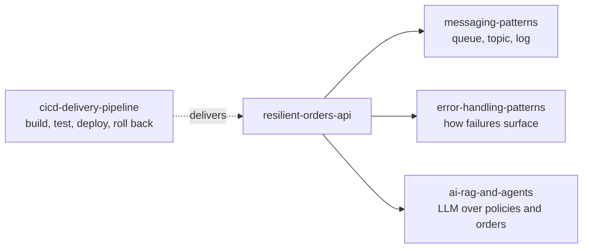

# Integration Architecture Portfolio

Integration architect working with MuleSoft and API-led design. This portfolio shows how I design for failure (idempotency, retries, messaging), deliver safely (CI/CD, rollback) and add AI features with guardrails.

Hands-on work in API-led integration on MuleSoft (Mule 4), organized by the architecture problem each project solves. Every repository has a diagram, the design decisions and trade-offs, and a table of behaviour that was actually run. Where something is written but not yet run, the README says so.

## Projects by architecture theme

| Theme | Repository | The problem it addresses | Key techniques |
|---|---|---|---|
| Resilience and idempotency | [resilient-orders-api](https://github.com/rk-hash4004/resilient-orders-api) | An order API that must not create duplicates or lose events when clients retry and downstream systems fail | Idempotency keys with request hashing, DB-enforced race handling, transactional outbox, retry with backoff and jitter, time budgets, circuit breaker, integration patterns (scatter-gather, enricher, splitter/aggregator, recipient list, claim check) |
| Messaging | [messaging-patterns](https://github.com/rk-hash4004/messaging-patterns) | Choosing and operating a queue, a topic or a log, and knowing what each does when things fail | JMS on Artemis (persistence, competing consumers, acknowledgement modes, durable subscriptions, ordering, transactions) and Kafka (keys and partitions, consumer groups, offsets, replay) |
| Error handling | [error-handling-patterns](https://github.com/rk-hash4004/error-handling-patterns) | Predictable failures: the right status, the right log, no hidden retries | Error types and namespaces, mapping, matching, continue vs propagate, handler levels, structured logging, retry and reconnection, async and concurrency behaviour |
| AI integration | [ai-rag-and-agents](https://github.com/rk-hash4004/ai-rag-and-agents) | Adding LLM features to an integration platform without losing control | RAG on pgvector with grounding and evaluation, LLM tool calling with validation, an iteration cap and a human-approval write path |
| Delivery and governance | [cicd-delivery-pipeline](https://github.com/rk-hash4004/cicd-delivery-pipeline) | Moving a Mule API to production safely and being able to undo it | GitHub Actions: CI with coverage gate, Exchange publish, DEV and QA deploy with health and version checks, manual production promotion, rollback to a published release |

## How the projects relate

## How to read a repository

1. The README diagram shows the shape of the solution.
2. "Design decisions and trade-offs" explains each choice and what it costs.
3. "Verified behaviour" lists what was run and what was observed. Anything not run is stated as such.
4. The flows are in `src/main/mule/`, grouped by topic.

## Stack

Mule 4.12 on Java 17, DataWeave, PostgreSQL (with pgvector), ActiveMQ Artemis, Apache Kafka, MUnit, GitHub Actions, CloudHub 2.0, Anypoint Exchange. Everything except the cloud deployment runs locally with Docker.
